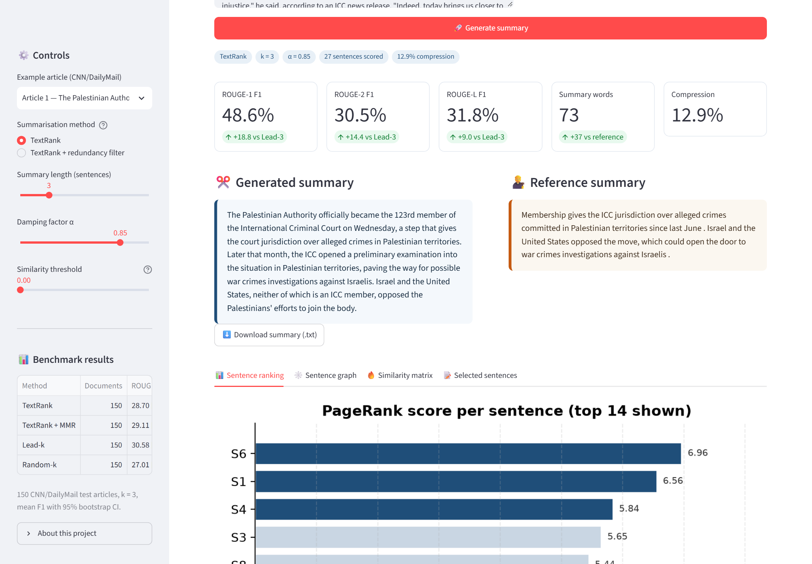
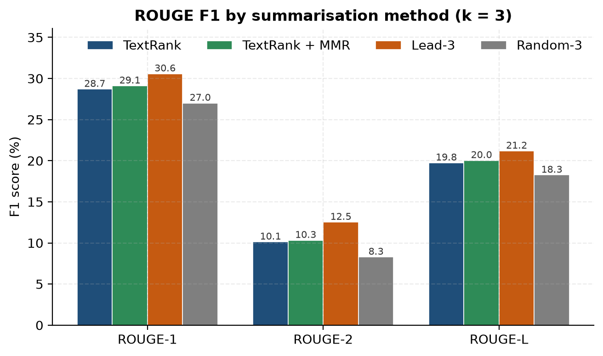

# Extractive Text Summarisation with TextRank

A compact, reproducible **TextRank** extractive summariser built from first principles, evaluated with **ROUGE-1 / ROUGE-2 / ROUGE-L** against human-written CNN/DailyMail summaries, and shipped with an interactive Streamlit demo.

No training, no GPU, no external LLM — sentences are nodes in a TF-IDF cosine-similarity graph, and PageRank decides which sentences enter the summary.

**Python 3.10+** · **MIT licensed** · **150 CNN/DailyMail test articles** · **~3.4 ms per article**



---

## Results at a glance

Primary comparison at **k = 3 sentences** (`n = 150` documents, mean F1 with 95% bootstrap confidence intervals):

| Method | ROUGE-1 F1 | ROUGE-2 F1 | ROUGE-L F1 | Avg. words | Compression |
|:--|--:|--:|--:|--:|--:|
| **TextRank** | **28.70** [27.10–30.36] | **10.13** [8.80–11.52] | **19.75** [18.46–21.02] | 70 | 18.5% |
| TextRank + MMR | 29.11 [27.53–30.70] | 10.33 [8.99–11.72] | 20.04 [18.80–21.32] | 70 | 18.3% |
| Lead-3 | 30.58 [28.69–32.51] | 12.53 [10.92–14.19] | 21.19 [19.64–22.77] | 66 | 17.5% |
| Random-3 | 27.01 [25.36–28.68] | 8.29 [7.03–9.69] | 18.26 [16.94–19.64] | 60 | 16.1% |

### What the numbers mean

- **TextRank significantly beats a random extractor** — +1.69 ROUGE-1 points, paired Wilcoxon *p* = 0.015; it wins on 85/150 documents. The graph ranking is learning genuine sentence importance.
- **Lead-3 is stronger on CNN/DailyMail** — 30.58 vs 28.70 ROUGE-1 (*p* = 0.026). News follows the inverted-pyramid convention and the human highlights were written under the same convention, so the first three sentences are an unusually strong baseline. TextRank still wins on 60/150 documents, mostly where the key facts appear later in the article.
- **A redundancy filter changes almost nothing at k = 3** — 29.11 vs 28.70 (*p* = 0.433). Short news extracts rarely contain near-duplicates.
- **The ranking consistently beats random at every summary length** (*k* = 2, 3, 4, 5, 6, 8), even though all methods decline as *k* grows because precision falls faster than recall rises.

These results are reported honestly rather than tuned to make TextRank look best. The full discussion, per-document analysis, qualitative wins/losses and limitations are in [`report/report.md`](report/report.md) and [`deliverables/project_report.pdf`](deliverables/project_report.pdf).



---

## How it works

```text
article
  → NLTK Punkt sentence segmentation (bundled model, offline)
  → lowercase, regex tokenisation, stopword removal, Porter stemming
  → sublinear TF-IDF sentence vectors (L2-normalised)
  → pairwise cosine similarity → undirected weighted graph
  → PageRank (α = 0.85, tol = 1e-8, max 200 iterations)
  → top-k sentences → restore original order → summary
  → ROUGE-1/2/L against the human reference
```

Key implementation choices:

| Choice | Value |
|:--|:--|
| Sentence segmentation | NLTK Punkt (`data/nltk_data`, offline) |
| Preprocessing | scikit-learn English stopwords + news boilerplate; Porter stemmer |
| Sentence representation | TF-IDF, sublinear term frequency, L2 norm |
| Similarity | Cosine; zero-weight edges removed |
| Graph ranking | NetworkX PageRank, damping α = 0.85 |
| Primary length | k = 3 sentences |
| Baselines | Lead-k (first k sentences), Random-k (seed 42) |
| Ablation | TextRank + MMR-style redundancy filter (cosine > 0.30) |
| Significance | 2,000-resample percentile bootstrap CI; paired two-sided Wilcoxon |

The pipeline is deliberately dependency-light: **scikit-learn** (TF-IDF), **NetworkX** (PageRank), **NLTK** (segmentation/stemming), **rouge-score** (evaluation), **matplotlib** and **Streamlit**.

---

## Quickstart

```bash
git clone https://github.com/<your-username>/textrank-summarizer.git
cd textrank-summarizer

python -m venv .venv

# Windows (PowerShell)
.venv\Scripts\Activate.ps1
# macOS / Linux
# source .venv/bin/activate

pip install -r requirements.txt
```

The dataset and the Punkt model are already cached in `data/`, so the pipeline runs offline immediately.

### Run the demo

```bash
streamlit run src/app.py
```

Open <http://localhost:8501>. The app lets you:

- choose one of the 150 CNN/DailyMail articles or paste/upload your own text;
- switch between plain TextRank and the redundancy-filtered variant;
- change summary length, damping factor α and the similarity threshold;
- see live ROUGE-1/2/L scores and the delta against Lead-k;
- inspect the PageRank sentence ranking, similarity matrix and sentence graph;
- download the generated summary as a `.txt` file.

Add `?demo=1` to the URL to pre-run the first example automatically (used for deterministic screenshots and the recorded demo).

### Reproduce every number and figure

```bash
python scripts/run_experiment.py        # results/ + results/figures/ (~10 s)
python scripts/build_notebook.py        # rebuilds and executes the notebook
```

`scripts/run_experiment.py` writes `per_document.csv` (one row per document × method × k), the main tables, paired significance tests, qualitative examples and all figures. Random operations are seeded with 42.

### Rebuild the PDF deliverables

```bash
python scripts/build_report.py          # report/report.md → deliverables/project_report.pdf
python scripts/build_screenshots_pdf.py # results/figures/app_*.png → deliverables/output_screenshots.pdf
```

- `build_report.py` renders styled HTML and prints it to PDF with headless Microsoft Edge. Set `EDGE_PATH` in the script if Edge is installed elsewhere.
- `build_screenshots_pdf.py` uses Pillow to lay out the screenshots; no browser is needed.
- `scripts/capture_app.py` re-captures the app screenshots with Playwright Chromium (install once with `python -m playwright install chromium`, with the app already running on port 8501).
- `scripts/capture_notebook.py` re-exports the executed notebook and captures the four notebook screenshots used in the PDF; run it after rebuilding the notebook or changing student details.

---

## Repository layout

```text
textrank-summarizer/
├── README.md
├── LICENSE
├── requirements.txt
├── data/
│   ├── cnn_dailymail_sample.json      150 articles + human highlights
│   └── nltk_data/                     bundled Punkt model (offline)
├── notebooks/
│   └── textrank_evaluation.ipynb      executed notebook, 27 cells, all outputs
├── src/
│   ├── dataset.py                     download / load the cached slice
│   ├── preprocess.py                  segmentation, tokenisation, stemming
│   ├── textrank.py                    TF-IDF graph + PageRank + extraction
│   ├── baselines.py                   Lead-k and Random-k
│   ├── evaluate.py                    ROUGE, bootstrap CI, Wilcoxon tests
│   ├── visualize.py                   report and app figures
│   └── app.py                         Streamlit demonstration
├── scripts/
│   ├── fetch_data.py                  re-download the dataset slice
│   ├── run_experiment.py              full evaluation → results/
│   ├── build_notebook.py              build + execute the notebook
│   ├── capture_app.py                 Playwright app screenshots
│   ├── capture_notebook.py            Playwright notebook screenshots
│   ├── build_report.py                Markdown → HTML → PDF report
│   ├── build_screenshots_pdf.py       screenshots compilation PDF
│   └── make_diagrams.py               pipeline and equation images
├── results/
│   ├── per_document.csv               per (document, method, k) scores
│   ├── metrics_by_method_k.csv        aggregate metrics for every k
│   ├── results_table_k3.csv           main results table
│   ├── paired_tests.json              bootstrap CIs + Wilcoxon tests
│   ├── examples.json                  best / median / worst cases
│   ├── run_metadata.json              dataset stats, config, versions
│   └── figures/                       all figures and app screenshots
├── report/
│   ├── report.md                      Markdown report source (generated)
│   ├── report.html                    rendered HTML
│   └── student.json                   single source of truth for cover details
├── docs/
│   └── DEMO_SCRIPT.md                 2–3 minute demo recording plan
└── deliverables/
    ├── project_report.pdf             17-page report
    ├── output_screenshots.pdf         23-page screenshot compilation
    └── demo_video.mp4                 recorded separately (not committed)
```

---

## Dataset

A fixed slice of the **CNN/DailyMail** test split (`abisee/cnn_dailymail`, config `3.0.0`) is cached in [`data/cnn_dailymail_sample.json`](data/cnn_dailymail_sample.json):

| Property | Value |
|:--|:--|
| Source | `abisee/cnn_dailymail`, version 3.0.0, test split |
| Articles | 150 (first rows of the split) |
| Mean sentences / article | 28.7 (median 24) |
| Mean words / article | 566 |
| Mean words / reference | 34.5 |
| Mean sentences / reference | 2.52 |
| Retrieval | HuggingFace datasets-server REST API, cached once |

To re-download the slice:

```bash
python scripts/fetch_data.py
```

The cache makes the notebook, experiments and app fully reproducible offline. The dataset remains subject to the terms of its [dataset card](https://huggingface.co/datasets/abisee/cnn_dailymail); it is included here only as a small research/evaluation sample.

---

## Deliverables and submission checklist

| Deliverable | Location | Status |
|:--|:--|:--|
| Executed notebook | `notebooks/textrank_evaluation.ipynb` | Done — 27 cells, 10 figures, 12 tables, 0 errors |
| Project report (PDF) | `deliverables/project_report.pdf` | Done — 17 pages |
| Output screenshots (PDF) | `deliverables/output_screenshots.pdf` | Done — 23 pages |
| Demo video (2–3 min) | `deliverables/demo_video.mp4` | Record with [`docs/DEMO_SCRIPT.md`](docs/DEMO_SCRIPT.md) |
| Public GitHub repository | this repository | Push and submit the URL |

**Before submitting, replace the placeholders:**

1. Edit [`report/student.json`](report/student.json) with your real name, roll number, semester, institution and guide.
2. Rebuild all three artefacts so the details propagate to every cover page:

   ```bash
   python scripts/build_notebook.py
   python scripts/capture_notebook.py
   python scripts/build_report.py
   python scripts/build_screenshots_pdf.py
   ```

3. Record the demo video following `docs/DEMO_SCRIPT.md`.
4. Push the repository and add the GitHub link (and optionally the video link) to your submission.

---

## Limitations

- **Single reference, lexical metric.** ROUGE rewards literal overlap; a valid extract that paraphrases the reference can score poorly. The reported scores are a lower bound on quality.
- **Small evaluation slice.** 150 test articles give stable means, but bootstrap intervals are reported rather than single-point claims.
- **News-specific prior.** Lead-3 is unusually strong on CNN/DailyMail because of the inverted-pyramid structure and lead bias of the highlights. The result does not imply that Lead-3 is a good general summariser.
- **Extractive only.** The system cannot abstract, fuse sentences or resolve pronouns; output is always a subset of source sentences.
- **Fixed preprocessing.** Segmentation, stopword list and threshold choices affect scores by a few points; all settings are fixed and documented.

## Future work

1. Position-aware PageRank initialisation (graph + news prior).
2. Sentence-BERT embeddings to capture paraphrase similarity.
3. A proper MMR/submodular selection objective for longer summaries.
4. BERTScore and human evaluation to complement ROUGE.

## References

1. Mihalcea, R., & Tarau, P. (2004). *TextRank: Bringing Order into Texts.* EMNLP 2004.
2. Page, L., Brin, S., Motwani, R., & Winograd, T. (1999). *The PageRank Citation Ranking: Bringing Order to the Web.* Stanford InfoLab.
3. Lin, C.-Y. (2004). *ROUGE: A Package for Automatic Evaluation of Summaries.* ACL Workshop.
4. Nallapati, R., et al. (2016). *Abstractive Text Summarization using Sequence-to-Sequence RNNs and Beyond.* CoNLL 2016.
5. Erkan, G., & Radev, D. R. (2004). *LexRank: Graph-based Lexical Centrality as Salience in Text Summarization.* JAIR 22.

## License

Code released under the [MIT License](LICENSE). The CNN/DailyMail sample remains subject to its original dataset licence and is included only for evaluation and reproducibility.
