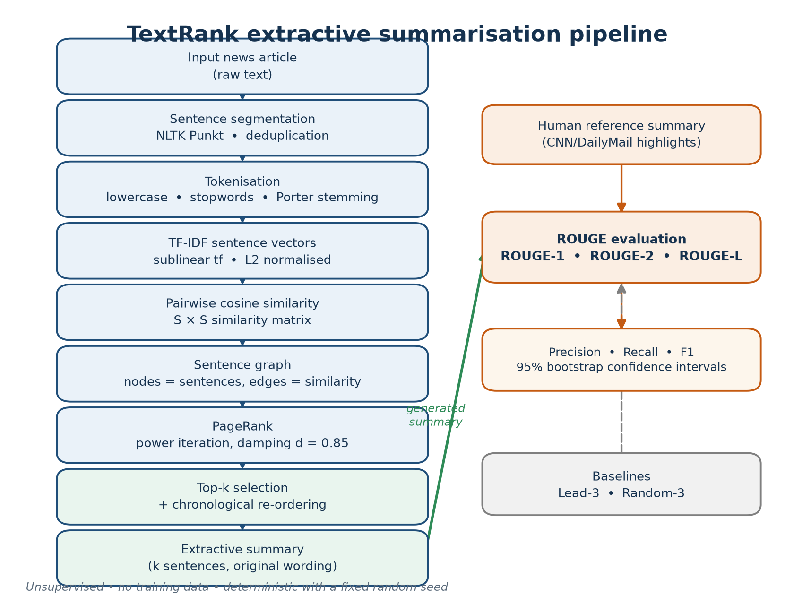
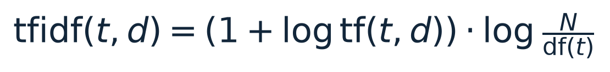
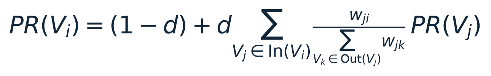
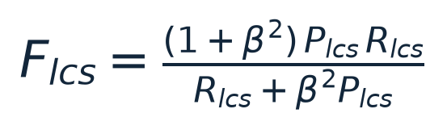
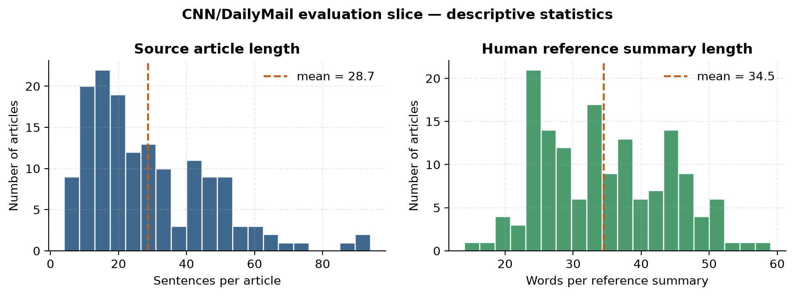
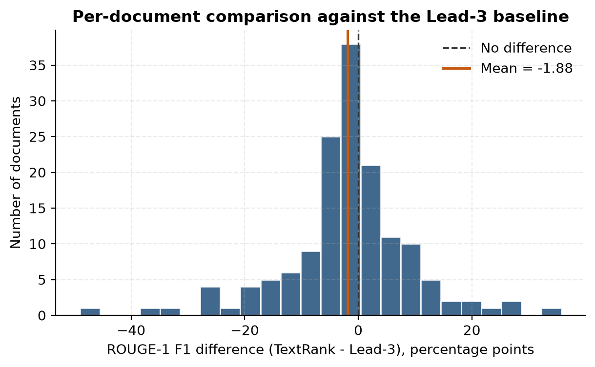
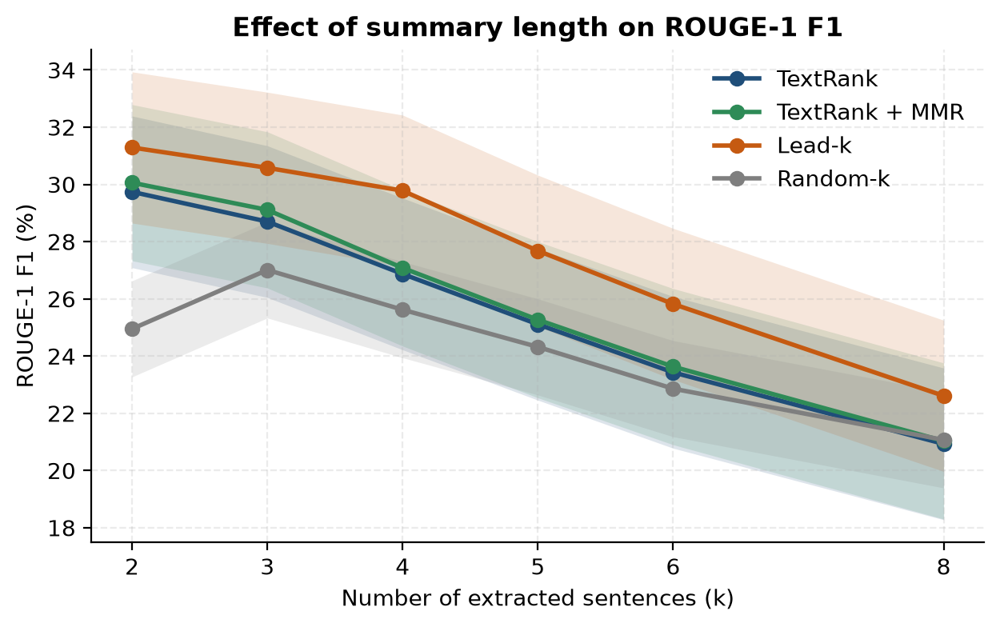
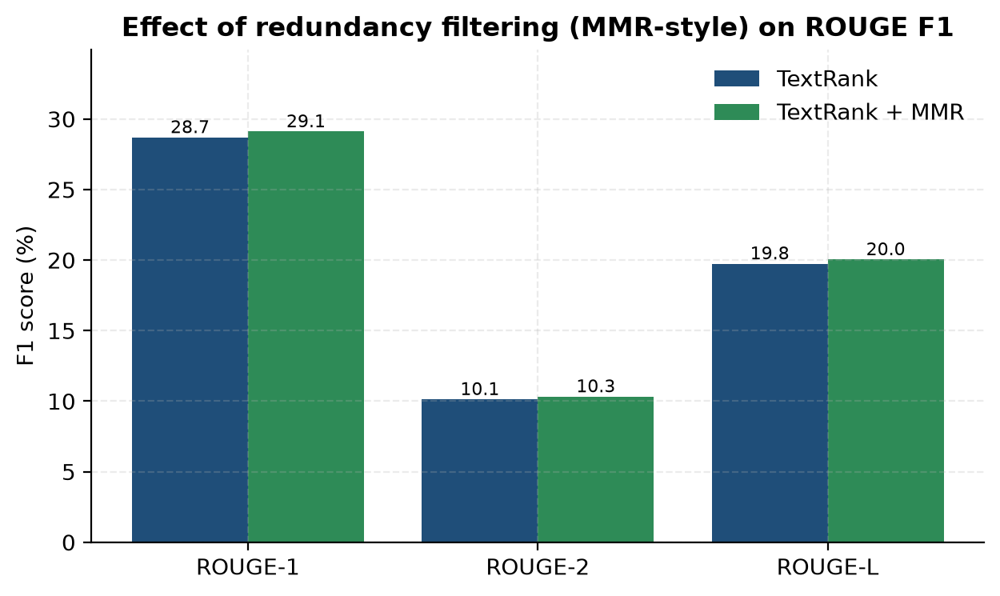
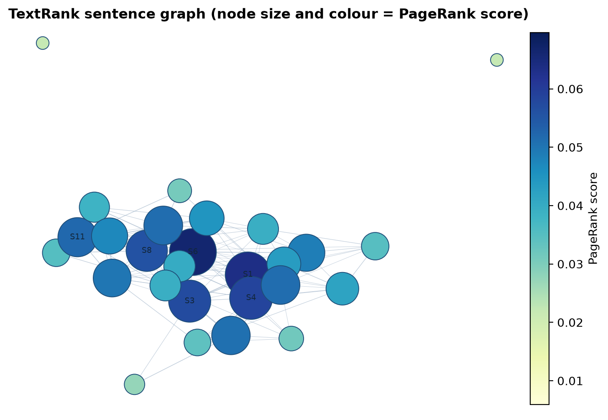

<div class="cover">
  <div class="cover-institution">Easa College of Engineering and Technology<br><span>BE-CSE (AIML)</span></div>
  <div class="cover-rule"></div>
  <div class="cover-kicker">MINI PROJECT REPORT</div>
  <h1 class="cover-title">Extractive Text Summarisation with TextRank</h1>
  <div class="cover-subtitle">A TF-IDF sentence-graph approach evaluated with ROUGE-1, ROUGE-2 and ROUGE-L</div>
  <table class="cover-table">
    <tr><td>Submitted by</td><td><strong>Sriram R</strong></td></tr>
    <tr><td>Roll number</td><td>E720524AM029</td></tr>
    <tr><td>Course</td><td>Natural Language Processing · Semester 5</td></tr>
    
  </table>
  <div class="cover-date">23 October 2026</div>
</div>

<div class="page-break"></div>

## Abstract

Automatic text summarisation reduces a long document to its most important content. This project implements an **extractive** summariser based on **TextRank**, an unsupervised graph-ranking algorithm. Sentences are represented as TF-IDF vectors, pairwise cosine similarity defines a weighted graph, and PageRank (damping factor *d* = 0.85) ranks sentences by recursive centrality. The top-*k* sentences are extracted and restored to their original order so that the summary reads naturally.

The system is evaluated on a fixed slice of 150 articles from the **CNN/DailyMail** test split using **ROUGE-1, ROUGE-2 and ROUGE-L** against human-written highlights. TextRank achieves **28.70 ROUGE-1 F1**, **10.13 ROUGE-2 F1** and **19.75 ROUGE-L F1** at three sentences per summary. It significantly outperforms a random extractor (+1.69 ROUGE-1 points, *p* = 0.015) but trails the Lead-3 baseline (30.58 ROUGE-1, *p* = 0.026), a result explained by the inverted-pyramid structure of news and the lead bias of the CNN/DailyMail references. A redundancy-filtered variant, a summary-length sweep, paired bootstrap confidence intervals and a Wilcoxon signed-rank test are reported to separate genuine algorithmic value from dataset artefacts. The complete pipeline is also deployed as an interactive Streamlit application.

**Keywords:** extractive summarisation, TextRank, PageRank, TF-IDF, ROUGE, CNN/DailyMail, unsupervised NLP

<div class="page-break"></div>

## Contents

1. Introduction
2. Background and related work
3. Methodology
4. Experimental setup
5. Results
6. Discussion
7. Conclusion and future work
8. References
9. Appendix A — Repository structure
10. Appendix B — Reproduction guide

### List of Figures

1. End-to-end TextRank summarisation and evaluation pipeline
2. Distribution of article and reference-summary lengths
3. ROUGE-1/2/L F1 for all methods at k = 3
4. Per-document ROUGE-1 difference between TextRank and Lead-3
5. ROUGE-1 F1 versus summary length
6. Redundancy-filter ablation
7. Sentence similarity graph for one article
8. Streamlit demonstration with live ROUGE metrics

### List of Tables

1. Dataset statistics for the evaluation slice
2. Experimental configuration
3. Software environment
4. Main ROUGE results at k = 3
5. Precision/recall/F1 breakdown
6. Paired significance tests
7. ROUGE-1 F1 by summary length
8. Redundancy-filter ablation

<div class="page-break"></div>

## 1. Introduction

### 1.1 Motivation

The volume of text produced every day — news wires, reports, transcripts, research articles — far exceeds the time available to read it. A summariser condenses a document while preserving its essential information. **Extractive** summarisation does this by selecting whole sentences from the source; **abstractive** summarisation rewrites them, potentially producing more fluent text but also risking factual drift and hallucination.

Extractive methods remain attractive in practice because they are faithful by construction: every word in the output was written by the original author. They are also cheap, deterministic, interpretable and do not require a labelled training set. The central research question is therefore *which sentences to select* — a ranking problem that graph-based algorithms such as TextRank address directly.

### 1.2 Problem statement

Given a document consisting of sentences *S* = (S₁, …, Sₙ), produce a summary of at most *k* sentences that maximises overlap with a human reference while remaining non-redundant and coherent. Naive strategies are weak: a random extract ignores content entirely, while taking the first *k* sentences exploits the layout of news but fails on documents whose key information appears later.

### 1.3 Objectives

1. Implement the complete TextRank pipeline from first principles: sentence segmentation, preprocessing, TF-IDF representation, cosine-similarity graph construction, PageRank scoring and ranked extraction.
2. Evaluate the summariser quantitatively with ROUGE-1, ROUGE-2 and ROUGE-L against human reference summaries on a standard benchmark.
3. Compare TextRank with **Lead-3** and **Random-3** baselines to measure genuine algorithmic value rather than the lead bias of news.
4. Study the effect of summary length and of a redundancy filter, and test the statistical significance of the differences.
5. Package the work as a reproducible notebook, an interactive Streamlit demo, and a complete public repository.

### 1.4 Contributions

* A clean, dependency-light implementation of TextRank that runs in about 3.3 ms per article on a CPU.
* A reproducible ROUGE evaluation on a cached CNN/DailyMail slice, with bootstrap confidence intervals and paired significance tests.
* An honest analysis of the Lead-3 effect, including per-document wins and losses.
* A working demonstration application with live ROUGE scoring, and the full replication package (notebook, scripts, figures, report).

### 1.5 Organisation

Section 2 reviews graph-based summarisation and ROUGE. Section 3 presents the methodology and equations. Section 4 describes the dataset, hyperparameters and protocol. Section 5 reports results; Section 6 discusses them and states limitations; Section 7 concludes.

## 2. Background and related work

### 2.1 Graph-based ranking

PageRank [2] assigns importance to nodes of a directed graph by simulating a random walk: a node is important if important nodes link to it. TextRank [1] transfers this idea to natural language by treating linguistic units — words, collocations or sentences — as nodes and similarity relations as weighted edges. For sentence extraction, an edge weight is the lexical similarity between two sentences, and the PageRank score of a sentence measures how central it is to the document's discourse. LexRank [6] uses the same intuition with IDF-modified cosine similarity and degree normalisation.

Unlike centroid-based ranking, which scores each sentence independently, graph ranking is *recursive*: a sentence gains importance by being similar to sentences that are themselves important. This captures the fact that central concepts are mentioned in several places, in different words.

### 2.2 Neural and other approaches

Recent abstractive systems based on sequence-to-sequence models, BART and Pegasus produce more fluent summaries, but they require large training corpora and GPUs and can hallucinate content. Extractive neural models (e.g. BERTSum) frame sentence selection as classification and need document-summary labels. TextRank remains a strong, transparent baseline and a useful teaching vehicle because every step is inspectable.

### 2.3 The Lead-3 baseline

News articles follow the **inverted pyramid**: the most newsworthy facts appear first. CNN/DailyMail highlights were written by editors under the same convention, so the first three sentences are an unusually strong baseline [4]. Any evaluation that omits it risks attributing the dataset's layout bias to the algorithm. We therefore report Lead-3 alongside Random-3 and discuss the gap explicitly.

### 2.4 ROUGE

ROUGE [3] measures n-gram overlap between a candidate and one or more references. ROUGE-1 counts unigram matches, ROUGE-2 counts bigrams (capturing local phrasing), and ROUGE-L uses the longest common subsequence, which rewards in-order sentence structure. All three are reported as precision, recall and F1. ROUGE is lexical: a semantically correct paraphrase can score poorly, which is why qualitative examples and per-document analysis accompany the aggregate numbers.

## 3. Methodology

### 3.1 System overview

<figure><figcaption>Figure 1. End-to-end TextRank summarisation and evaluation pipeline.</figcaption></figure>

The pipeline has two branches. The **summarisation** branch converts the article into a sentence graph, ranks sentences with PageRank and extracts the top-*k*. The **evaluation** branch scores the generated summary against the human reference with ROUGE, and repeats the process for the baselines.

### 3.2 Preprocessing

The article is segmented with NLTK's Punkt tokeniser, using a local copy of the model so the notebook runs offline. Sentences shorter than four tokens are discarded (they are usually datelines, captions or fragments), and exact duplicates are removed to prevent redundancy from inflating similarity.

Each sentence is lowercased, tokenised with a regular expression that preserves hyphenated compounds and numbers, stripped of stopwords, and Porter-stemmed. The stopword list combines the scikit-learn English list with a small set of news-boilerplate words (*said*, *also*, *would*, …) that would otherwise create spurious similarity. A sentence with no remaining content tokens is dropped because it cannot be ranked meaningfully.

### 3.3 Sentence representation

Each sentence is represented as a sparse TF-IDF vector over the document vocabulary:

<p class="eq"></p>

where *tf(t, d)* is the term frequency of term *t* in sentence *d*, *df(t)* is the number of sentences containing *t*, and *N* is the number of sentences. Sublinear term frequency prevents a repeated word from dominating; the logarithm down-weights terms that occur throughout the article. Vectors are L2-normalised so that the dot product equals cosine similarity.

### 3.4 Similarity graph

Pairwise similarity is computed for every sentence pair:

<p class="eq"></p>

The similarity matrix is symmetric with a zero diagonal. It is converted into an undirected weighted graph: nodes are sentences, edge weights are similarities, and zero-weight edges are removed. In practice the matrix is sparse and low-valued — most sentence pairs share few content words — which is exactly why recursive centrality is more informative than raw term overlap.

### 3.5 PageRank

The PageRank score of sentence *Vᵢ* is:

<p class="eq"></p>

The damping factor *d* = 0.85 is the standard value: with probability 0.85 the walk follows an edge proportionally to its weight, and with probability 0.15 it jumps to a random sentence. The denominator normalises the contribution of an incoming neighbour by its total outgoing weight, so a sentence connected to many weakly related sentences does not accumulate undue importance. Scores are computed by power iteration with a tolerance of 10⁻⁸ and a cap of 200 iterations.

### 3.6 Extraction and ordering

Sentences are sorted by descending PageRank score and the top-*k* are selected. Selected sentences are then **re-sorted by their original position** before concatenation. Without this step the summary would be a bag of fluent but disjointed sentences; with it, the extract follows the narrative order of the source. The number of sentences *k* is the only length control, making compression directly comparable across methods.

As an ablation, *TextRank + MMR* greedily skips a candidate whose cosine similarity to an already selected sentence exceeds 0.30, then fills the remaining budget with the next-best candidates. In TF-IDF space 0.30 is already in the extreme tail of the similarity distribution, so the filter targets near-duplicates rather than paraphrases.

### 3.7 Baselines

* **Lead-3** returns the first three sentences. It is a strong, widely reported news baseline.
* **Random-3** samples three sentences uniformly without replacement using seed 42. Averaged over documents it estimates the score of a content-blind summariser.

### 3.8 Evaluation metrics

For a candidate *C* and reference *R*, ROUGE-1 and ROUGE-2 compute clipped n-gram overlap and report precision, recall and F1. ROUGE-L uses the length of the longest common subsequence *LCS*:

<p class="eq"></p>

where *m* and *n* are the lengths of *R* and *C*, *β* controls the precision/recall trade-off (set to 1 for F1), and *P_lcs* and *R_lcs* are the LCS-based precision and recall. Scores are computed with `rouge-score` using Porter stemming, the standard convention in summarisation research.

### 3.9 Statistical protocol

Aggregate means alone can hide variance across documents. We therefore report **95% percentile bootstrap confidence intervals** (2,000 resamples) for every mean, and compare methods with a **two-sided Wilcoxon signed-rank test** on paired per-document ROUGE differences. The test is non-parametric and appropriate because the same 150 documents are used for every method.

## 4. Experimental setup

### 4.1 Dataset

**Table 1. Dataset statistics for the evaluation slice.**

| Property                     | Value                                               |
|:-----------------------------|:----------------------------------------------------|
| Corpus                       | CNN/DailyMail (abisee/cnn_dailymail), version 3.0.0 |
| Split                        | test, first 150 articles                            |
| Reference summaries          | Human-written highlights (multi-sentence)           |
| Articles evaluated           | 150                                                 |
| Mean sentences per article   | 28.7                                                |
| Median sentences per article | 24                                                  |
| Mean words per article       | 566                                                 |
| Mean words per reference     | 34.5                                                |
| Mean sentences per reference | 2.52                                                |
| Cache file                   | data/cnn_dailymail_sample.json                      |


CNN/DailyMail is the standard benchmark for summarisation. Each example pairs a news article with multi-sentence highlights written by editors. We use the first 150 articles of the test split, cached locally after a one-time download from the HuggingFace datasets server. The slice is large enough for stable means and small enough that every document can be inspected.

<figure><figcaption>Figure 2. Distribution of article length and reference-summary length in the evaluation slice.</figcaption></figure>

### 4.2 Hyperparameters

**Table 2. Experimental configuration.**

| Parameter                       | Value                                                          |
|:--------------------------------|:---------------------------------------------------------------|
| Summary length (primary)        | k = 3 sentences                                                |
| Length sweep                    | 2, 3, 4, 5, 6, 8                                               |
| Similarity                      | TF-IDF cosine (sublinear tf, L2 normalised)                    |
| Stopwords                       | scikit-learn English list + news boilerplate                   |
| Stemming                        | Porter stemmer                                                 |
| Minimum sentence length         | 4 tokens                                                       |
| Graph                           | Undirected, complete weighted graph, zero-weight edges removed |
| PageRank damping factor         | 0.85                                                           |
| PageRank max iterations         | 200                                                            |
| PageRank tolerance              | 1e-08                                                          |
| Redundancy threshold (ablation) | 0.3                                                            |
| Random seed                     | 42                                                             |
| ROUGE implementation            | rouge-score 0.1.2, use_stemmer=True                            |
| Confidence intervals            | Percentile bootstrap, 2,000 resamples, 95%                     |
| Significance test               | Two-sided Wilcoxon signed-rank, paired by document             |


### 4.3 Implementation and environment

**Table 3. Software environment used for the reported results.**

| Component    | Version   |
|:-------------|:----------|
| Python       | 3.14.3    |
| numpy        | 2.5.4     |
| pandas       | 3.1.0     |
| scikit-learn | 1.9.1     |
| nltk         | 3.10.4    |
| networkx     | 3.7       |
| rouge-score  | 0.1.2     |
| matplotlib   | 3.11.2    |
| streamlit    | 1.66.1    |
| scipy        | 1.18.1    |


The implementation is organised as importable modules (`src/`) shared by the notebook, the experiment runner and the web application. The full evaluation — 150 documents × 6 summary lengths × 4 methods = 3,600 summaries — runs in 6.6 seconds on a laptop CPU, excluding ROUGE scoring.

### 4.4 Protocol

Every method extracts exactly *k* = 3 sentences for the primary comparison, matching the average reference length of 2.5 sentences. The length sweep repeats the evaluation for *k* ∈ {2, 3, 4, 5, 6, 8}. All methods are evaluated on the same documents and against the same references; ROUGE uses Porter stemming.

## 5. Results

### 5.1 Main comparison

**Table 4. ROUGE F1 at k = 3 with 95% bootstrap confidence intervals, mean summary length and compression ratio (n = 150 documents).**

| Method         | ROUGE-1 F1          | ROUGE-2 F1          | ROUGE-L F1          |   Avg. words | Compression   |
|:---------------|:--------------------|:--------------------|:--------------------|-------------:|:--------------|
| TextRank       | 28.70 [27.10-30.36] | 10.13 [8.80-11.52]  | 19.75 [18.46-21.02] |           70 | 18.5%         |
| TextRank + MMR | 29.11 [27.53-30.70] | 10.33 [8.99-11.72]  | 20.04 [18.80-21.32] |           70 | 18.3%         |
| Lead-3         | 30.58 [28.69-32.51] | 12.53 [10.92-14.19] | 21.19 [19.64-22.77] |           66 | 17.5%         |
| Random-3       | 27.01 [25.36-28.68] | 8.29 [7.03-9.69]    | 18.26 [16.94-19.64] |           60 | 16.1%         |


<figure><figcaption>Figure 3. ROUGE-1, ROUGE-2 and ROUGE-L F1 for all methods at k = 3.</figcaption></figure>

TextRank achieves **28.70 ROUGE-1 F1**, **10.13 ROUGE-2 F1** and **19.75 ROUGE-L F1**. Three findings stand out:

1. **TextRank beats the random baseline on every metric.** The ROUGE-1 gain is +1.69 points and is statistically significant (*p* = 0.015). This isolates genuine algorithmic value: the graph ranking is learning something about sentence importance.
2. **Lead-3 is 1.88 ROUGE-1 points stronger** (30.58 vs 28.70; *p* = 0.026). The difference is small but consistent, and is discussed in Section 6.
3. **Redundancy filtering gives a negligible gain** (29.11 vs 28.70; *p* = 0.433). Three-sentence summaries from short news articles rarely contain near-duplicates, so there is little for the filter to remove.

TextRank selects longer sentences on average (70 words vs 66 for Lead-3) while covering a similar fraction of the source (18.5% vs 17.5%). Because ROUGE precision penalises extra words, this difference is a mild disadvantage for TextRank; it is nonetheless the honest output of the algorithm.

### 5.2 Precision and recall

**Table 5. Full precision/recall/F1 breakdown at k = 3 (%).**

| Method         |   R-1 P |   R-1 R |   R-1 F1 |   R-2 P |   R-2 R |   R-2 F1 |   R-L P |   R-L R |   R-L F1 |
|:---------------|--------:|--------:|---------:|--------:|--------:|---------:|--------:|--------:|---------:|
| TextRank       |   21.6  |   46.51 |    28.7  |    7.52 |   16.77 |    10.13 |   14.81 |   32.1  |    19.75 |
| TextRank + MMR |   21.9  |   47.12 |    29.11 |    7.72 |   16.97 |    10.33 |   15.06 |   32.45 |    20.04 |
| Lead-3         |   23.28 |   48.77 |    30.58 |    9.42 |   20.61 |    12.53 |   16.03 |   34.22 |    21.19 |
| Random-3       |   21.46 |   39.53 |    27.01 |    6.49 |   12.54 |     8.29 |   14.45 |   27.05 |    18.26 |


All methods have higher precision than recall, which is expected: a three-sentence extract is shorter than most references, so much of the reference content is never covered. Lead-3's precision advantage (+1.68 points of ROUGE-1 precision) reflects the fact that its sentences concentrate on the article's main event, while TextRank sometimes selects a central background sentence that the reference omits.

### 5.3 Statistical significance

**Table 6. Paired comparisons for ROUGE-1 F1 at k = 3 (positive difference favours TextRank).**

| Comparison                 |   Mean difference (pp) | 95% CI (pp)    | TextRank wins   |   Wilcoxon p |
|:---------------------------|-----------------------:|:---------------|:----------------|-------------:|
| TextRank vs Lead-3         |                  -1.88 | [-3.74, -0.11] | 60/150          |       0.026  |
| TextRank vs Random-3       |                   1.69 | [+0.17, +3.17] | 85/150          |       0.0152 |
| TextRank vs TextRank + MMR |                  -0.41 | [-1.15, +0.24] | 13/150          |       0.4331 |


The paired analysis is more informative than the means. TextRank wins on 60 of 150 documents against Lead-3, loses on 84, and ties on 6: the baseline's advantage comes from a subset of documents with a very strong lede, not from uniform dominance. Against Random-3, TextRank wins on 85 documents and loses on 63. The MMR comparison is statistically indistinguishable from zero, confirming that the ablation changes little.

<figure><figcaption>Figure 4. Distribution of per-document ROUGE-1 F1 differences between TextRank and Lead-3.</figcaption></figure>

### 5.4 Effect of summary length

**Table 7. ROUGE-1 F1 (%) as the number of extracted sentences varies.**

|   k |   TextRank |   TextRank + MMR |   Lead-3 |   Random-3 |
|----:|-----------:|-----------------:|---------:|-----------:|
|   2 |      29.74 |            30.06 |    31.29 |      24.95 |
|   3 |      28.7  |            29.11 |    30.58 |      27.01 |
|   4 |      26.87 |            27.08 |    29.78 |      25.62 |
|   5 |      25.11 |            25.27 |    27.68 |      24.32 |
|   6 |      23.43 |            23.63 |    25.82 |      22.86 |
|   8 |      20.93 |            21.03 |    22.61 |      21.07 |


<figure><figcaption>Figure 5. ROUGE-1 F1 versus summary length, with 95% confidence bands.</figcaption></figure>

All methods peak at a short length and then decline, because precision falls faster than recall rises. TextRank trails Lead-3 by 1.55 points at *k* = 2; the gap peaks at 2.90 points at *k* = 4 and narrows to 1.68 points at *k* = 8. TextRank also beats Random-3 at every length, so the graph ranking is consistently more informative than content-blind selection; it does not, however, overcome the positional prior of the news lede.

### 5.5 Redundancy-filter ablation

**Table 8. ROUGE-1 F1 with and without the MMR-style redundancy filter.**

|   k |   TextRank R-1 |   TextRank + MMR R-1 |   Delta (pp) |
|----:|---------------:|---------------------:|-------------:|
|   2 |          29.74 |                30.06 |         0.32 |
|   3 |          28.7  |                29.11 |         0.41 |
|   4 |          26.87 |                27.08 |         0.21 |
|   5 |          25.11 |                25.27 |         0.16 |
|   6 |          23.43 |                23.63 |         0.2  |
|   8 |          20.93 |                21.03 |         0.1  |


<figure><figcaption>Figure 6. Ablation at k = 3: plain TextRank versus the redundancy-filtered variant.</figcaption></figure>

The filter is neutral on this dataset. The likely reason is document length: with roughly 29 sentences per article and a three-sentence budget, a top-3 set rarely contains two sentences with cosine similarity above 0.30. On longer documents or larger *k*, the filter should matter more; that is a natural extension.

### 5.6 Qualitative analysis

<figure><figcaption>Figure 7. Sentence similarity graph for one article. Node colour and size encode PageRank score; labelled nodes are highly ranked sentences.</figcaption></figure>

The graph above makes the algorithm's behaviour visible. Highly scored nodes sit at the centre of the similarity network: they are not necessarily the first sentences, but they are connected to many other sentences. Isolated nodes — often quotations or tangential details — receive low scores and are not selected.


<div class="example-card">
<div class="example-head"><strong>Largest gain over Lead-3</strong> &nbsp;·&nbsp; document <code>6344c9689865cf86da50fbe90acf13c3407d5429</code></div>
<div class="example-rouge">ROUGE-1 F1 &nbsp; TextRank <strong>47.5%</strong> &nbsp;|&nbsp; Lead-3 <strong>11.8%</strong></div>
<p><span class="tag tag-blue">TextRank</span> Cifuentes&#x27; case is dramatic, but in Guatemala, where nearly 10 out of every 100,000 women are killed, it&#x27;s hardly unusual. A 2012 Small Arms Survey says gender-based violence is at epidemic levels in Guatemala and the country ranks third in the killings of women worldwide. According to the United Nations, two women are killed there every day.</p>
<p><span class="tag tag-orange">Lead-3</span> For 12 years Adelma Cifuentes felt worthless, frightened and alone, never knowing when her abusive husband would strike. But as a young mother in rural Guatemala with three children and barely a third grade education, she thought there was no way out. What began as psychological torment, name-calling and humiliation turned into beatings so severe Cifuentes feared for her life.</p>
<p><span class="tag tag-grey">Reference</span> Gender-based violence is at epidemic levels in Guatemala . According to the United Nations, two women are killed in Guatemala every day . Five abuse survivors known as La Poderosas have been appearing in a play based on their real life stories .</p>
</div>


<div class="example-card">
<div class="example-head"><strong>Median document</strong> &nbsp;·&nbsp; document <code>8be49747e364357d7c5d32fca516ec230e5083ed</code></div>
<div class="example-rouge">ROUGE-1 F1 &nbsp; TextRank <strong>45.8%</strong> &nbsp;|&nbsp; Lead-3 <strong>46.9%</strong></div>
<p><span class="tag tag-blue">TextRank</span> A University of Kentucky basketball player is apologizing for the &quot;poor choice of words&quot; he muttered under his breath after the team&#x27;s stunning loss to Wisconsin on Saturday. Harrison, who is is black, said his words were &quot;in jest,&quot; and that he meant no disrespect to Kaminsky, who is white. &quot;First I want to apologize for my poor choice of words used in jest towards a player I respect and know,&quot; Harrison tweeted.</p>
<p><span class="tag tag-orange">Lead-3</span> A University of Kentucky basketball player is apologizing for the &quot;poor choice of words&quot; he muttered under his breath after the team&#x27;s stunning loss to Wisconsin on Saturday. As a deflated panel of Wildcats fielded a reporter&#x27;s question about Wisconsin standout Frank Kaminsky, a hot mic picked up Kentucky guard Andrew Harrison saying of Kaminsky, &quot;F**k that (N-word).&quot; Harrison, who is is black, said his words were &quot;in jest,&quot; and that he meant no disrespect to Kaminsky, who …</p>
<p><span class="tag tag-grey">Reference</span> Kentucky player mutters N-word under his breath about a Wisconsin player at postgame news conference . Andrew Harrison, who is black, tweets that he apologized to Frank Kaminsky, who is white . Kaminsky says he&#x27;s talked it over with Harrison -- &#x27;I&#x27;m over it&quot;</p>
</div>


<div class="example-card">
<div class="example-head"><strong>Largest loss to Lead-3</strong> &nbsp;·&nbsp; document <code>84dabfdd73c25b81b7ea0ce23e74638cc6c559ce</code></div>
<div class="example-rouge">ROUGE-1 F1 &nbsp; TextRank <strong>20.8%</strong> &nbsp;|&nbsp; Lead-3 <strong>69.8%</strong></div>
<p><span class="tag tag-blue">TextRank</span> &quot;Without men, it is not possible for women to get their rights,&quot; she says. &quot;And you have to struggle for your rights. Who will get the rights for us?</p>
<p><span class="tag tag-orange">Lead-3</span> An Amnesty International report is calling for authorities to address the number of attacks on women&#x27;s rights activists in Afghanistan. The report, entitled &quot;Their Lives on the Line,&quot; examines the persecution of activists and other champions of women&#x27;s rights not only by the Taliban and tribal warlords, but also by government officials. Its publication is timely.</p>
<p><span class="tag tag-grey">Reference</span> An Amnesty International report calls for attacks on women&#x27;s rights activists in Afghanistan to be investigated . The report examines the persecution of activists not only by the Taliban and tribal warlords, but also by government officials . Some activists continue their work despite their lives being at risk .</p>
</div>


The best case (+35.8 ROUGE-1 points) is an article whose lede is scene-setting and whose key facts appear later: the graph finds them, while Lead-3 cannot. The worst case (-49.0 points) shows the opposite pattern — a tightly written inverted-pyramid article in which the first three sentences already contain almost every reference fact. TextRank spends part of its budget on a central but background sentence, and precision falls.

### 5.7 Efficiency

At *k* = 3, TextRank takes **3.24 ms** per article on average, including TF-IDF construction and PageRank. Lead-3 takes 0.01 ms and Random-3 0.03 ms. The full 3,600-summary evaluation takes 6.6 s, with ROUGE scoring accounting for most of the wall-clock time. The method is therefore suitable for interactive use, which is why the demo can score summaries live.

### 5.8 Demonstration application

<figure><figcaption>Figure 8. Streamlit demonstration: generated summary, reference summary and live ROUGE metrics.</figcaption></figure>

The Streamlit application exposes the same pipeline with controls for method, summary length, damping factor and similarity threshold. It computes ROUGE against a pasted reference and shows the sentence ranking, similarity heatmap and graph. Automated screenshots are collected in `deliverables/output_screenshots.pdf`.

## 6. Discussion

### 6.1 Why Lead-3 is hard to beat

The result is a property of the benchmark, not a defect in the implementation. CNN/DailyMail articles are news stories written in inverted-pyramid style, and the highlights were written by editors who read the same article and followed the same news values. The first two or three sentences therefore contain a disproportionate share of reference content. Lead-3 benefits from a positional prior that exactly matches the data-generating process, while TextRank is position-agnostic and must infer salience from lexical structure alone.

TextRank nevertheless does what it is designed to do. It beats a random extractor significantly at every summary length, and its wins cluster on articles whose important content is not at the top. The per-document analysis (Figure 4) shows a distribution centred slightly below zero but with a long right tail: on a meaningful minority of documents, the graph finds a better summary than the lede.

### 6.2 Implications for design

If the goal is the best possible ROUGE on news, a position prior is the obvious next step: initialise PageRank with a decaying positional vector, or blend the PageRank score with a lead score. That hybrid would retain the graph's ability to find later content while exploiting the strong prior. If the goal is domain independence, pure TextRank is the safer choice — it has no built-in assumption about where information lives.

The redundancy filter is worth keeping as an option but is not a priority for short news summaries. A proper MMR objective, which jointly optimises relevance and novelty rather than applying a hard threshold, would be a cleaner formulation.

### 6.3 Threats to validity

* **Sample size.** The evaluation uses 150 test articles. Bootstrap intervals quantify the resulting uncertainty, but they do not eliminate it.
* **Single reference.** CNN/DailyMail has one reference per article; a valid extract that paraphrases it can score low. ROUGE is a lower bound on quality.
* **Preprocessing sensitivity.** Sentence segmentation and stopword choice affect the graph. The configuration is fixed and reported, but different choices would shift scores by a few points.
* **Threshold selection.** The 0.30 redundancy threshold was chosen from the similarity distribution, not tuned on the test set. It is reported as an ablation, not as a tuned result.
* **Implementation variants.** TextRank has many published variants (directed graphs, windowed co-occurrence, degree normalisation). We implement the sentence-similarity formulation of Mihalcea and Tarau and state the choices explicitly.

### 6.4 Ethical considerations

Extractive summarisation cannot fabricate facts, which is a meaningful safety advantage over abstractive models. It can, however, amplify selection bias: if the graph systematically favours certain perspectives, the summary inherits that bias. It can also produce misleading summaries by removing necessary context. Any deployment should preserve a link to the source and make clear that the output is an extract.

## 7. Conclusion and future work

This project implemented TextRank from first principles and evaluated it rigorously against human summaries. The pipeline — sentence segmentation, TF-IDF representation, cosine-similarity graph, PageRank with *d* = 0.85, ranked extraction and chronological re-ordering — is compact, interpretable and fast (3.2 ms per article). On 150 CNN/DailyMail test articles it reaches 28.70 ROUGE-1 F1, 10.13 ROUGE-2 F1 and 19.75 ROUGE-L F1, significantly beating a random baseline while trailing the strong Lead-3 baseline. The analysis explains both outcomes and identifies where the graph adds value.

Future work will pursue four directions: (i) a position-aware PageRank initialisation to combine the graph with the news prior; (ii) embedding-based sentence representations (Sentence-BERT) to capture paraphrase; (iii) a proper MMR or submodular selection objective for longer summaries; and (iv) evaluation with BERTScore and human judgements to complement lexical ROUGE.

## 8. References

1. Mihalcea, R., & Tarau, P. (2004). TextRank: Bringing Order into Texts. *Proceedings of EMNLP 2004*, 404–411.
2. Page, L., Brin, S., Motwani, R., & Winograd, T. (1999). The PageRank Citation Ranking: Bringing Order to the Web. *Stanford InfoLab Technical Report*.
3. Lin, C.-Y. (2004). ROUGE: A Package for Automatic Evaluation of Summaries. *ACL Workshop on Text Summarization Branches Out*.
4. Nallapati, R., Zhou, B., Gulcehre, C., & Xiang, B. (2016). Abstractive Text Summarization using Sequence-to-Sequence RNNs and Beyond. *CoNLL 2016*.
5. Hermann, K. M., Kočiský, T., Grefenstette, E., Espeholt, L., Kay, W., Suleyman, M., & Blunsom, P. (2015). Teaching Machines to Read and Comprehend. *NeurIPS 2015*.
6. Erkan, G., & Radev, D. R. (2004). LexRank: Graph-based Lexical Centrality as Salience in Text Summarization. *Journal of Artificial Intelligence Research, 22*, 457–479.
7. Lewis, M., et al. (2020). BART: Denoising Sequence-to-Sequence Pre-training for Natural Language Generation, Translation, and Comprehension. *ACL 2020*.
8. Zhang, J., Zhao, Y., Saleh, M., & Liu, P. (2020). PEGASUS: Pre-training with Extracted Gap-sentences for Abstractive Summarization. *ICML 2020*.
9. scikit-learn developers. TfidfVectorizer documentation. https://scikit-learn.org/stable/modules/generated/sklearn.feature_extraction.text.TfidfVectorizer.html
10. NetworkX developers. PageRank documentation. https://networkx.org/documentation/stable/reference/algorithms/generated/networkx.algorithms.link_analysis.pagerank_alg.pagerank.html

<div class="page-break"></div>

## 9. Appendix A — Repository structure

```text
textrank-summarizer/
├── README.md
├── requirements.txt
├── data/
│   ├── cnn_dailymail_sample.json     150 articles + reference summaries
│   └── nltk_data/                    bundled Punkt model (offline)
├── notebooks/
│   └── textrank_evaluation.ipynb     executed notebook with all outputs
├── src/
│   ├── dataset.py                    download / load the cached slice
│   ├── preprocess.py                 segmentation, tokenisation, stemming
│   ├── textrank.py                   TF-IDF graph + PageRank + extraction
│   ├── baselines.py                  Lead-k and Random-k
│   ├── evaluate.py                   ROUGE, bootstrap CI, Wilcoxon tests
│   ├── visualize.py                  all report and app figures
│   └── app.py                        Streamlit demonstration
├── scripts/
│   ├── fetch_data.py                 re-download the dataset slice
│   ├── run_experiment.py             full evaluation -> results/
│   ├── build_notebook.py             build + execute the notebook
│   ├── capture_app.py                Playwright app screenshots
│   ├── capture_notebook.py           Playwright notebook screenshots
│   ├── build_report.py               Markdown -> HTML -> PDF report
│   ├── build_screenshots_pdf.py      screenshots compilation PDF
│   └── build_demo_video.py           narrated MP4 demo generator
├── results/
│   ├── per_document.csv              one row per (document, method, k)
│   ├── results_table_k3.csv          main results table
│   ├── paired_tests.json             significance tests
│   ├── examples.json                 best / median / worst cases
│   └── figures/                      all figures and app screenshots
├── report/
│   ├── report.md                     Markdown source (regenerated by this script)
│   └── student.json                  student details for the cover
└── deliverables/
    ├── project_report.pdf
    ├── output_screenshots.pdf
    └── demo_video.mp4                narrated walkthrough (GitHub release)
```

## 10. Appendix B — Reproduction guide

```bash
# 1. Environment
python -m venv .venv
.venv\Scripts\activate
pip install -r requirements.txt

# 2. Dataset (already cached; this re-downloads it)
python scripts/fetch_data.py

# 3. Evaluation: writes results/ and results/figures/
python scripts/run_experiment.py

# 4. Notebook (builds and executes every cell)
python scripts/build_notebook.py
python scripts/capture_notebook.py

# 5. Interactive demo
streamlit run src/app.py

# 6. Report and screenshots PDF
python scripts/build_report.py
python scripts/build_screenshots_pdf.py

# 7. Narrated demo video (Windows SAPI)
python scripts/build_demo_video.py
```

All random operations are seeded (seed 42); rerunning the commands above reproduces the reported numbers exactly, up to library-version differences.

<div class="page-break"></div>

<div class="declaration">
<h2>Declaration</h2>
<p>I declare that this mini project report is my own work. The implementation, experiments, figures and analysis were produced by me, and all external sources, libraries and datasets are acknowledged in the references and in the repository README.</p>
<table class="signature">
<tr><td>Name: Sriram R</td><td>Signature: ______________________</td></tr>
<tr><td>Roll number: E720524AM029</td><td>Date: 23 October 2026</td></tr>
</table>
</div>
